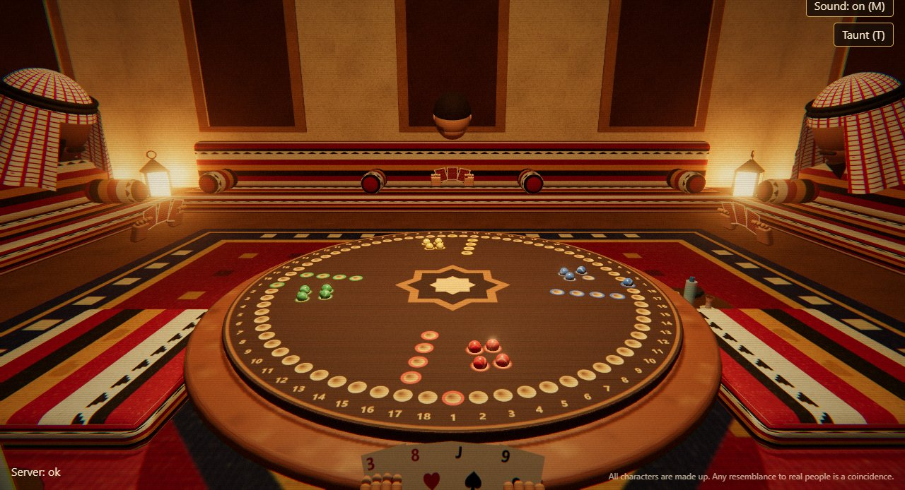
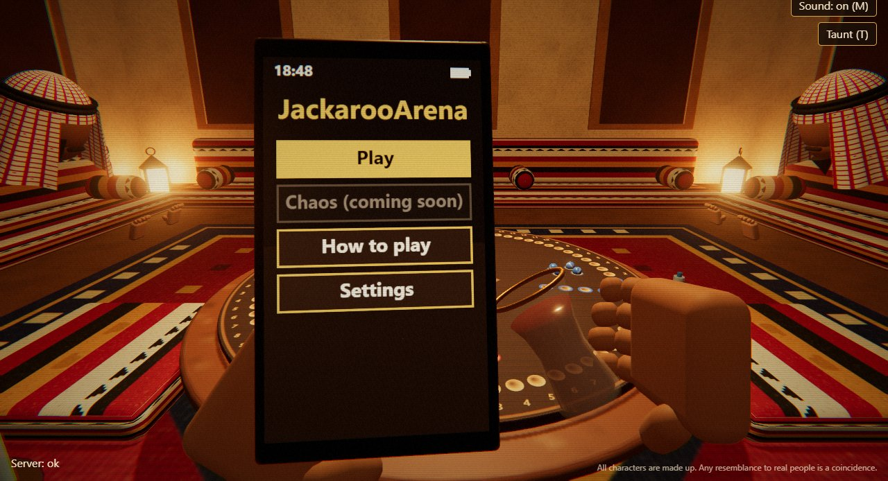

<p align="center"></p>

<h1 align="center">JackarooArena</h1>

<p align="center"><b>Online Jackaroo with your friends, in a warm majlis.</b></p>

A loud, chill 4-player Jackaroo party game in the browser. Make a room, share the 4-letter
code, and sabotage your friends' marbles around the board, 2 against 2. No account and no
download: bots fill empty seats, and the server keeps every hand hidden so nobody can cheat.

**Live:** https://jackarooarena.abdullahkamran823.workers.dev · **Version:** 0.1.0 · **Plays in:** any modern browser

[](https://github.com/4bdulllahh/jackarooarena/actions/workflows/ci.yml)


<p align="center"></p>

> The players in the screenshots are bots.

## Features

- **Rooms with a code.** Create a room, share the 4-letter code or link, pick your seat and team.
- **Bots fill empty seats.** Play with friends or alone; a bot also covers anyone who takes longer than 15 seconds.
- **Upgraded Levant house rules.** 7 splits, the 5 that moves any marble, red 10, J and Q tricks, the K that kills its whole path.
- **No cheating.** Dealing, hands and every move are handled on the server.
- **A cosy 3D majlis.** Warm lights and shadows, lanterns, a chandelier, and a soft retro TV filter.
- **Your phone is the menu.** Play, How to play and Settings on a phone in your hand; Esc brings it back in a game.
- **Taunts.** Six quick taunts with sounds and speech bubbles (T).
- **Settings.** Master, game sound and taunt volume, and Low, Medium or High graphics.

| The phone menu | At the table |
| --- | --- |
|  |  |

## Privacy

No accounts and no tracking. Your name, sound and graphics settings stay in your browser.
A game lives on the server only while its room is in use, and empty rooms are deleted after an hour.

## For developers

```
npm install
npm run dev        # game + Worker + rooms on http://localhost:5173
npm run check      # lint, format check, typecheck, tests, build
npm run deploy     # build and deploy to Cloudflare
```

Vite + three.js + TypeScript, with a Cloudflare Worker and one Durable Object per room.
See [handover.md](handover.md) for the full picture.

© Abdullah. All rights reserved. Made by [Abdullah](https://abdullahexe.online).
